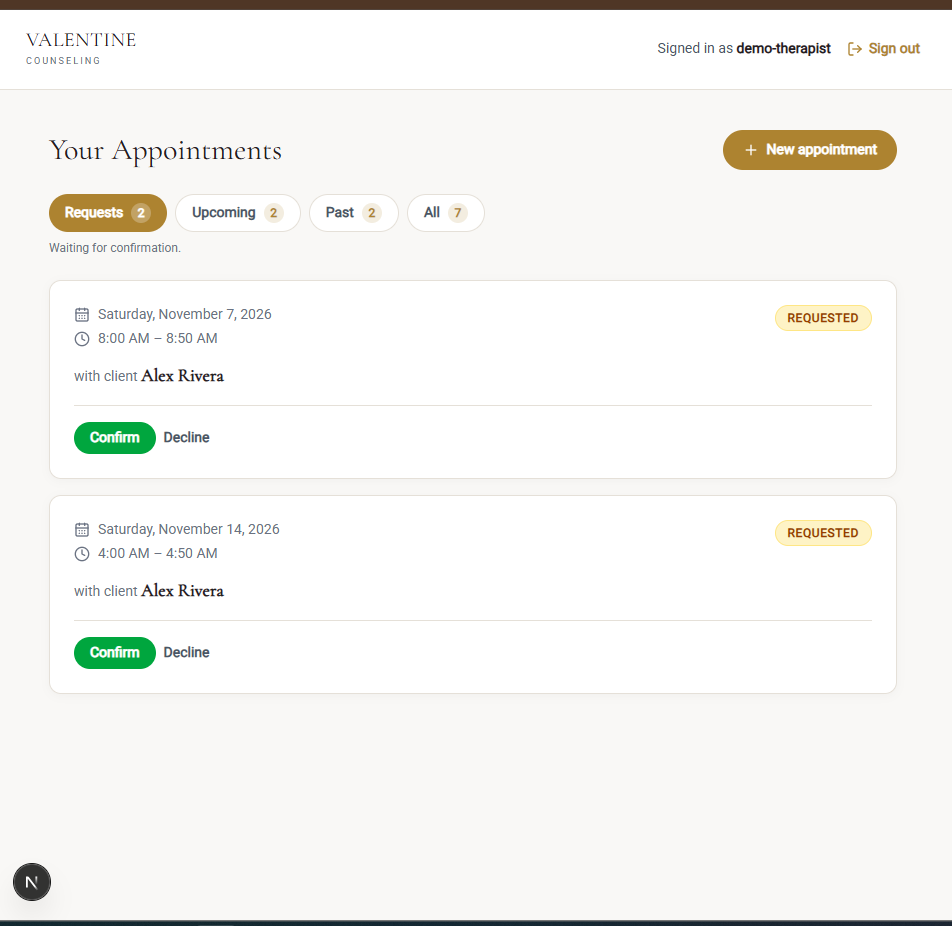
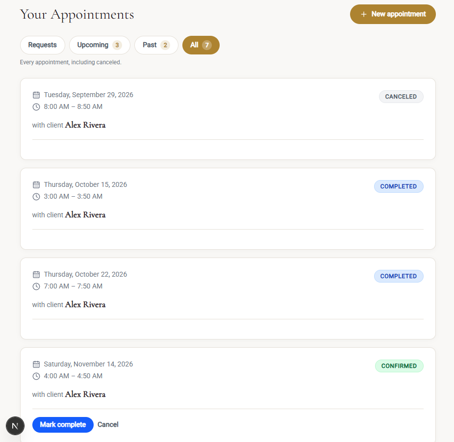
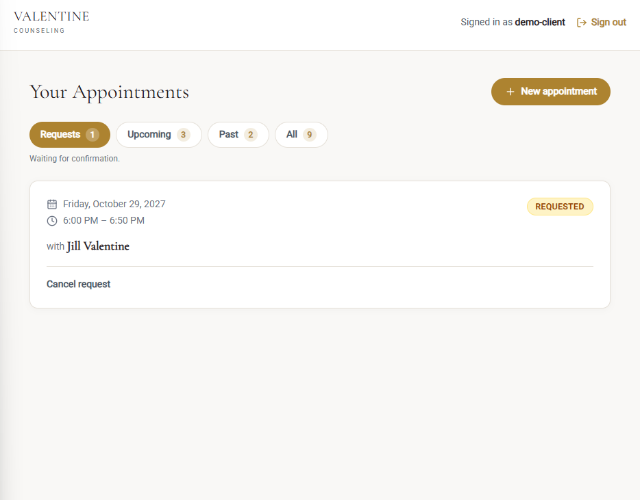
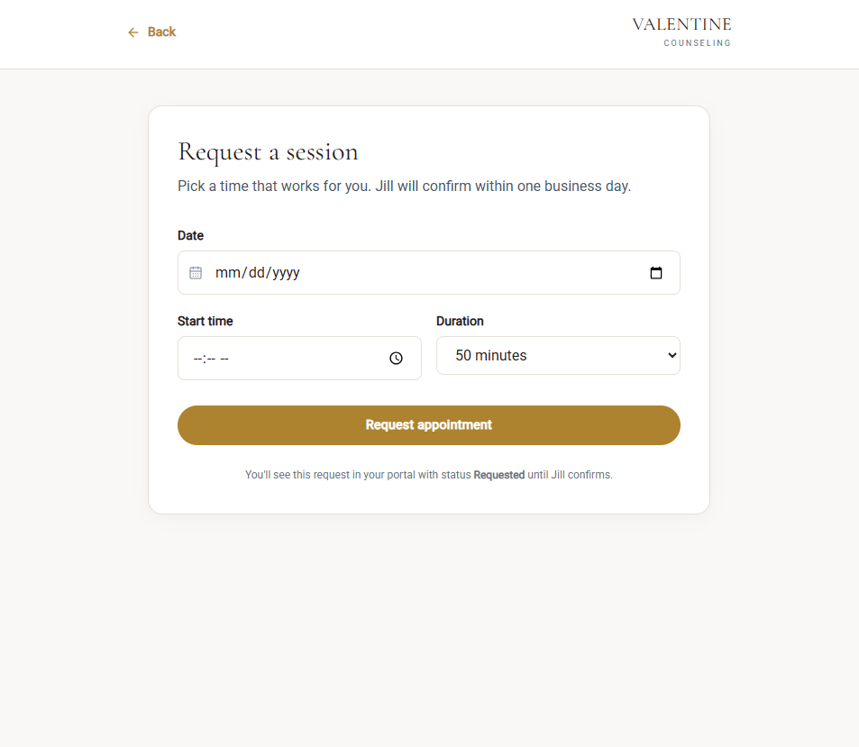

# Valentine Counseling — Full-Stack Scheduling Platform

A production-grade appointment scheduling API and client portal for a small
private therapy practice. Django REST Framework backend, Next.js frontend,
role-based access control, append-only PHI access audit logging.

**Live demo:** https://your-demo-url.com *(demo credentials on the login page)*

---

## Screenshots

| Therapist view — pending requests | Therapist view — upcoming sessions |
|---|---|
|  |  |

| Client portal | Booking a session |
|---|---|
|  |  |

---

## What it does

- **Clients** request appointments online, view status updates, cancel requests
  before confirmation.
- **Therapists** review their panel, confirm or decline requests, mark sessions
  complete.
- **Admins** manage users and profiles through Django admin; every access to
  patient data is logged for HIPAA audit purposes.

## Security model

The interesting part of this project is not the CRUD — it's the access-control
layer.

- **Role-based queryset filtering.** All appointment reads go through a single
  `get_queryset()` filter that restricts results to the logged-in user's panel.
  Cross-tenant access returns 404, not 403 — the row is not in the queryset.
- **Server-side ownership enforcement.** Clients cannot create appointments for
  another user, cannot reassign `client` / `therapist` via PATCH, and cannot
  change status beyond `REQUESTED` / `CANCELED`. Every ownership field is forced
  server-side in `perform_create` / `perform_update`.
- **Append-only audit log.** `PHIAccessLog` middleware writes a row for every
  API request touching patient data (who, when, what method, what path, what
  status, from what IP). The log is read-only even for superusers; API `DELETE`
  on appointments returns 405 to preserve HIPAA record retention.
- **Token auth with login throttling.** `POST /api-token-auth/` is rate-limited
  to 5 attempts/minute per IP. Registration is disabled in production.
- **Time validation.** Server-side checks for `start < end`, overlap detection
  per therapist (excluding canceled appointments), and time-lock on
  `CONFIRMED` appointments for non-therapist users.

## Stack

- **Backend:** Django 6, Django REST Framework, PostgreSQL (SQLite in dev),
  Gunicorn, Whitenoise
- **Frontend:** Next.js 16 (App Router), TypeScript, Tailwind CSS v4
- **Auth:** DRF token authentication with custom registration endpoint
- **Deploy:** Railway (API + database), Vercel (frontend), Namecheap (domain)

## API

| Method | Endpoint | Notes |
|--------|----------|-------|
| `POST` | `/api-token-auth/` | Exchange credentials for a token |
| `POST` | `/api/register/` | Client signup (disabled in prod) |
| `GET` | `/api/me/` | Current user profile |
| `GET` `POST` | `/api/appointments/` | List / create (filtered by role) |
| `GET` `PATCH` | `/api/appointments/{id}/` | Retrieve / update (owner only) |
| `DELETE` | `/api/appointments/{id}/` | **405** — records retained |

## Local setup

```bash
# Backend
python -m venv .venv && source .venv/bin/activate
pip install -r requirements.txt
python manage.py migrate
python manage.py createsuperuser
python manage.py runserver

# Frontend (separate terminal)
cd frontend
npm install
npm run dev